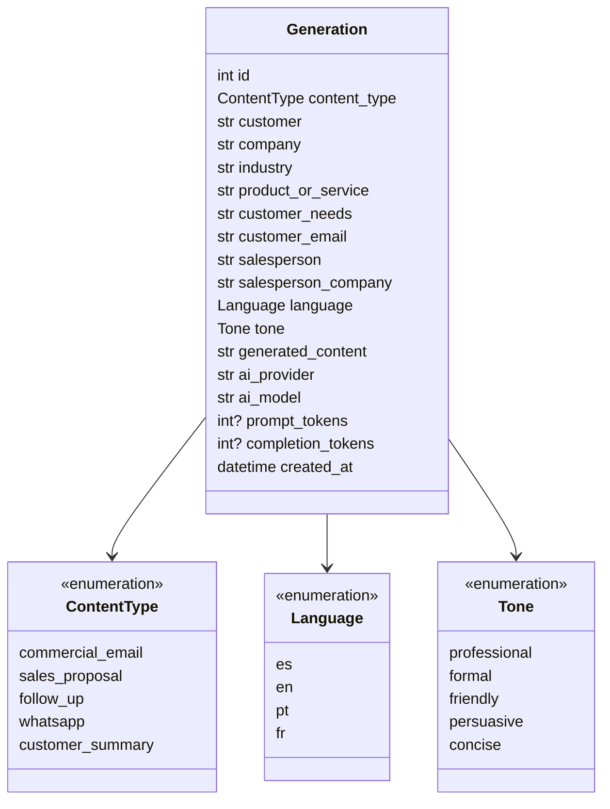

# 05. Domain Model

## Entity: Generation

A piece of commercial content generated by AI, stored together with the input it was based on and the model that produced it. It is immutable once created: Version 1 has no update or delete.

| Attribute | Type | Description |
| --------- | ---- | ----------- |
| `id` | integer | Identifier |
| `content_type` | ContentType | What was generated |
| `customer` | text (≤150) | Contact person: the recipient |
| `company` | text (≤150) | Customer's company |
| `industry` | text (≤100) | Customer's sector |
| `product_or_service` | text (≤200) | What is being offered |
| `customer_needs` | text (≤2000) | Needs or pain points |
| `price_cents` | integer, optional | Original price in euro cents (exposed as `price`, Decimal) |
| `discount_basis_points` | integer, optional | Discount in hundredths of a percent (exposed as `discount_percent`); requires a price |
| `customer_email` | email (≤254), optional | Customer's email: pre-fills the recipient of «Enviar por correo». Never sent to the AI |
| `salesperson` | text (≤150), optional | Sender of the communication; signs it. Empty for older generations |
| `salesperson_company` | text (≤150), optional | Sender's company, which offers the product or service |
| `language` | Language | Output language |
| `tone` | Tone | Tone of voice |
| `generated_content` | text | AI output |
| `ai_provider` | text | `openai` or `ollama` |
| `ai_model` | text | Exact model version reported by the provider |
| `prompt_tokens` | integer, optional | Input tokens (internal, not exposed by the API) |
| `completion_tokens` | integer, optional | Output tokens (internal, not exposed by the API) |
| `created_at` | datetime (UTC) | Creation time |

### Design notes

- **One entity instead of separate request and result entities.** In Version 1 every request produces exactly one result, so splitting them would only add a join.
- **Customer data is a snapshot inside each generation.** Customer Management is planned for Version 3; a `customer_id` can then be added without breaking existing data.

## Entities: User, UserSession, PasswordResetToken

| Entity | Fields | Notes |
| ------ | ------ | ----- |
| `User` | `id`, `name`, `email` (unique, lowercase), `username` (optional, unique), `password_hash` (Argon2id), `is_guest`, `ai_generation_count`, `created_at`, `password_changed_at` | Owns generations. Guests have no email or password and are temporary |
| `UserSession` | `id`, `user_id`, `token_hash` (SHA-256, unique), `created_at`, `expires_at` | One per login; deleted on logout |
| `PasswordResetToken` | `id`, `user_id`, `token_hash` (SHA-256, unique), `created_at`, `expires_at`, `used_at` | Single-use, expiring |

`Generation.user_id` references its owner. It is nullable only for generations created before accounts existed, which no user can see until they are assigned with `python -m app.cli assign-orphan-generations`.

## Value objects (enums)

| Enum | Values |
| ---- | ------ |
| `ContentType` | `commercial_email`, `sales_proposal`, `follow_up`, `whatsapp`, `customer_summary` |
| `Language` | `es`, `en`, `pt`, `fr` |
| `Tone` | `professional`, `formal`, `friendly`, `persuasive`, `concise` |

## Supporting concepts (not persisted)

| Concept | Description |
| ------- | ----------- |
| `PromptTemplate` | Task and output format for one content type |
| `Prompt` | Rendered system and user text sent to a provider |
| `AIResult` | Provider-neutral result: content, provider, model, token usage |

## Diagram

