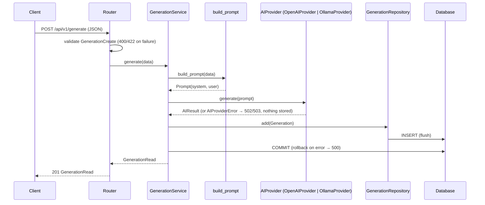

# 08. Architecture

## Layers

```
Client (Swagger UI, curl, future Bootstrap frontend)
     │  HTTP / JSON
     ▼
FastAPI Routers ............ app/routers        receive, validate (Pydantic), call service, respond
     │  Depends()
     ▼
Service Layer .............. app/services       use cases, transactions
     │                 │
     ▼                 ▼
Repository Layer       AI Provider ............ app/services/ai   (+ app/prompts)
app/repositories          │
     │                    ▼
     ▼                 OpenAI Responses API | Ollama /api/chat
SQLAlchemy ORM ......... app/models, app/database
     │
     ▼
SQLite (Version 1) / PostgreSQL (Version 2)
```

Cross-cutting modules:

- `app/core`: enums, constants, exceptions, error handlers, logging
- `app/config`: settings
- `app/schemas`: DTOs
- `app/api`: v1 router, dependency wiring, OpenAPI error docs

## Request flow: POST /api/v1/generate



## Authentication and ownership

`CurrentUserDep` resolves the user from the session cookie (`AuthService.authenticate`) or raises 401. Generation routes pass `user.id` to `GenerationService`, which passes it to every `GenerationRepository` query, so ownership is enforced at the data-access layer. Two middlewares wrap every request: an origin check for state-changing methods (CSRF) and security headers (`nosniff`, `X-Frame-Options: DENY`, `Referrer-Policy`). Web pages `/app` and `/account` redirect to `/login` without a session. See [ADR 0013](../adr/0013-authentication.md).

## Dependency injection

```
get_generation_service(session, resolve_ai_provider)
 ├─ get_db()                    one Session per request, always closed
 ├─ GenerationRepository(session)
 └─ get_ai_provider_resolver()  → get_ai_provider (lru_cache: one provider per process)
```

- **Lazy provider:** the service only resolves the provider inside `generate()`, so the read endpoints work without an API key.
- **Reuse:** the provider instance, and with it the HTTP connection pool (OpenAI or Ollama), is shared across requests. Creation failures are not cached.
- **Tests:** `app.dependency_overrides` replaces `get_db` (in-memory SQLite) and `get_ai_provider_resolver` (`FakeAIProvider`).

## Application startup

`app/main.py:create_app()`:

1. Loads the settings and configures logging.
2. Creates the FastAPI app with OpenAPI metadata.
3. Registers the exception handlers.
4. Includes the system router and the `/api/v1` router.

It contains no business logic.

## Extension points

| Future need | Where it plugs in |
| ----------- | ----------------- |
| PostgreSQL (Version 2) | `DATABASE_URL` + driver; no code changes in services |
| Docker (Version 2) | Configuration is already environment-driven; `docker/` folder reserved |
| Authentication (Version 2) | FastAPI dependency on the `/api/v1` router |
| Hugging Face (Version 4) | New `AIProvider` adapter registered in the factory, as done for Ollama ([ADR 0012](../adr/0012-ollama-provider.md)) |
| RAG (Version 4) | Context retrieval before `build_prompt` in the service |
| Bootstrap UI | Jinja2 templates in `app/templates`, assets in `app/static` |

Architectural decisions: see [`docs/adr`](../adr/README.md).
